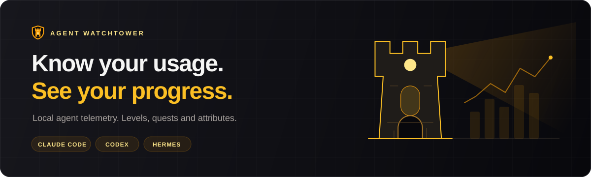
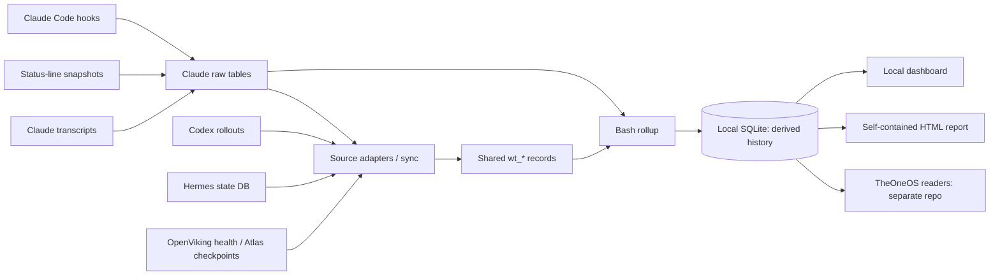

<p align="center">
  
</p>

<h1 align="center">Agent Watchtower</h1>

<p align="center"><strong>Your agent usage, with a character sheet.</strong><br>Active hours · Tokens &amp; costs · Levels to 200 · Six attributes · Weekly quests</p>

<p align="center">
  <a href="https://github.com/RaDeleon/Agent-Watchtower/releases/latest"></a>
  <a href="LICENSE"></a>
  <a href="https://github.com/RaDeleon/Agent-Watchtower/stargazers"></a>
  <a href="https://github.com/RaDeleon/Agent-Watchtower/commits"></a>
  <a href="https://github.com/RaDeleon/Agent-Watchtower"></a>
  <a href="https://github.com/RaDeleon/Agent-Watchtower"></a>
</p>

<p align="center">
  
  
  
</p>

<p align="center">
  <a href="#whats-new">What's new</a> ·
  <a href="#quick-start">Quick start</a> ·
  <a href="#dashboard">Dashboard</a> ·
  <a href="#character-attributes-and-quests">Character &amp; quests</a> ·
  <a href="#how-it-works">Architecture</a> ·
  <a href="#configuration">Configuration</a>
</p>

### Built with

[](#source-map)

**TypeScript + Node.js** for the CLI, source adapters and dashboard; **Bash + jq + SQLite** for capture and rollups; **Vitest** for fixture-based verification. The dashboard serves generated HTML through `node:http`, with no framework or npm runtime dependencies.

---

Watchtower turns local agent activity into a dashboard you can inspect: how long you worked, which projects and models you used, where tokens went, and how your habits changed. It started with Claude Code and now brings **Claude Code, Codex and Hermes** into one database, alongside lightweight OpenViking and Atlas signals.

It also turns that history into a character sheet. Tools, projects, models and Claude Code skills earn XP from observed active time, on a curve that runs to level 200. Six attributes grade how you work, not only how long. Weekly quests target your weakest habits, and achievements mark milestones already present in your history.

> [!NOTE]
> Watchtower is an experimental project installed from source. It passively reads activity and captures Claude Code hook events. It does not route model requests. Costs, usage scores and levels have explicit limits described below.

## What you get

| Feature | What it tells you |
| --- | --- |
| **Active time** | Work and think windows derived from consecutive events, with idle gaps bounded. |
| **Request usage** | Transcript-backed token counts, model and available skill/MCP/plugin attribution. |
| **Project history** | Daily hours and usage per repository, with exclusions and display groups. |
| **Performance** | API-price estimates, response median/p90, output speed, turn wait and cache behavior. |
| **Live view** | Rate-limit rings, the current Claude session, today, this week and an event ticker, refreshed every few seconds. |
| **Usage Profile** | Ten observable discipline scores and their trends, with missing data shown explicitly. |
| **Character** | Tool levels to 200 with tiers past Master, project/model sub-skills, Claude Code skills and packs, pace, streaks, level caps and level-up history. |
| **Attributes** | Six D&D stats (STR, DEX, CON, INT, WIS, CHA), each with a 30- and 7-day Form, a Base level trained by hours and Form, and a Now level this week boosts or drains. |
| **Quests & achievements** | Weekly habit targets, dated bronze-to-platinum milestones, Quest Points and Achievement Points. |
| **Portable reports** | A self-contained HTML report with the historical views and range controls. |
| **Themes** | Five colour themes and two navigation layouts, switched in place and remembered by your browser. |

## What's new

| Version | Date | Highlights |
| --- | --- | --- |
| [1.0.0](docs/release-notes/1.0.0.md) | 2026-10-25 | First public release, as Agent Watchtower, under the Apache License 2.0. The features of 0.10.0. No schema change (v11). |
| [0.10.0](docs/release-notes/0.10.0.md) | 2026-10-22 | `watchtower setup`: one guided command from checkout to dashboard. `install.sh` gains `--dry-run` and `--status-line` and now requires `sqlite3`. The config file is also found in the checkout. No schema change (v11). |
| [0.9.0](docs/release-notes/0.9.0.md) | 2026-10-15 | Six character attributes with Form, Base and Now levels. Levels run to 200, with Grandmaster, Legend, Mythic and Eternal past Master, and global level caps. Schema v11. |
| [0.8.0](docs/release-notes/0.8.0.md) | 2026-10-12 | First tagged release: capture and accounting, the dashboard, Codex and Hermes, levels, skills, quests and achievements. Schema v10. |

Every release from 1.0.0 on, with its source archive and checksum, is on the [releases page](https://github.com/RaDeleon/Agent-Watchtower/releases). The 0.x releases were published from a private repository, now archived; their notes are in [docs/release-notes/](docs/release-notes/). [docs/releases.md](docs/releases.md) describes how releases are made.

## Supported sources

| Source | Reads | Coverage |
| --- | --- | --- |
| **Claude Code** | Hooks, status-line snapshots and `~/.claude/projects` transcripts | Detailed usage, active time, performance, attribution, skills and weekly quests. |
| **Codex** | Rollout files under `~/.codex` | Sessions, events, token usage, active time for recognized driven sessions, API-price estimates and progression. |
| **Hermes** | `~/.hermes/state.db`, opened read-only | Sessions, message activity, reported usage/cost and progression for recognized driven sessions. |
| **OpenViking** | Local last-recall/last-capture state and a configured `/health` endpoint | Health, recall and capture metadata. No memory bodies, active hours or levels. |
| **Atlas** | `.atlas/sessions.db` under configured project roots | Checkpoint provenance linked to Claude sessions. No active hours or levels. |

Sources are enabled by default, and `watchtower setup` asks about each one it detects. An absent source is reported as **not detected**. Codex and Hermes classify entry points as driven, automated or unclassified; only driven sessions earn active hours and levels. These sources do not all expose the same measurements.

## Quick start

### Requirements

- **macOS or Linux**, with `bash`, `jq` and the `sqlite3` CLI on `PATH`.
- **Node.js 22.18+ on the 22.x line, or a newer version with default TypeScript stripping**, plus npm. The CLI runs TypeScript directly, without a build step. See [Node's TypeScript support](https://nodejs.org/api/typescript.html#type-stripping).
- Local history from the tools you want to track. Claude Code hooks add activity evidence going forward; transcript backfill recovers request history.

### 1. Get the source

Clone the repository:

```bash
git clone https://github.com/RaDeleon/Agent-Watchtower.git
cd Agent-Watchtower
npm ci
```

Or download the latest release's source archive and its checksum, verify it, and unpack it:

```bash
gh release download --repo RaDeleon/Agent-Watchtower --pattern 'agent-watchtower-*'
shasum -a 256 -c agent-watchtower-*.tar.gz.sha256   # sha256sum -c on Linux
tar -xzf agent-watchtower-*.tar.gz
cd agent-watchtower-*/
```

Watchtower has no runtime npm dependencies. `npm ci` installs only the tools for testing and type checking, so a release archive runs without it.

### 2. Run setup

```bash
./bin/watchtower setup
```

Setup checks your requirements, then asks a few questions before it writes anything: wire the status line, enable each detected source (one question per source), read your existing history now, put `watchtower` on your PATH, and open the dashboard. It shows a `diff -u` of `settings.json` and asks "Apply?" before installing, and it ends with the exact command for anything you declined. On an existing install, pressing Enter at every question keeps it exactly as it is.

Run without a terminal, setup installs capture only. `--yes` takes the defaults shown, and flags such as `--no-status-line` or `--disable codex,hermes` answer a question ahead of time (`./bin/watchtower --help` lists them). Tokens, cost and the Usage Profile cover your past history. Active hours, levels and quests start with your next Claude Code session, because archived transcripts do not recreate hook events.

<details>
<summary>Install by hand (also the route without Node)</summary>

### Step A. Preview and install Claude Code capture

```bash
# Preview the settings.json change; nothing is written.
bash capture/install.sh --dry-run

# Or preview the generated scripts and settings in an isolated directory.
preview_dir=$(mktemp -d)
CLAUDE_DIR="$preview_dir" bash capture/install.sh
cat "$preview_dir/settings.json"

# Install into ~/.claude once you have reviewed the preview.
bash capture/install.sh
```

The preview is a real installation into the temporary directory. The live installer backs up replaced files into `~/.claude/backups/`, registers capture on eight hook events, and preserves unrelated hooks and their matcher scoping. On `SessionEnd`, transcript ingestion and rollup run in the background.

**Status-line capture.** If Claude Code has no status line yet, `bash capture/install.sh --status-line` wires `watchtower-snapshot.sh` as the status line (an existing status line is never edited). Otherwise follow the installer's message to feed your status-line JSON into `~/.claude/watchtower-snapshot.sh`, keeping a single writer; duplicate capture would duplicate snapshots.

### Step B. Backfill, resolve and sync

```bash
~/.claude/watchtower-ingest.sh --backfill
~/.claude/claude-usage-rollup.sh --resolve
./bin/watchtower sync
```

Backfill reads archived Claude requests. `--resolve` resolves pending project paths. Sync projects all detected enabled sources into the shared tables and runs the installed rollup. Archived token history does not recreate missing historical hook events.

### Step C. Open the dashboard

```bash
./bin/watchtower
```

This opens [http://127.0.0.1:4317](http://127.0.0.1:4317), starts the server in the background when needed, and returns control to your terminal. To make `watchtower` available on your PATH:

```bash
mkdir -p ~/.local/bin
ln -s "$PWD/bin/watchtower" ~/.local/bin/watchtower
```

Ensure `~/.local/bin` is on your PATH. The link points at this checkout, so keep it in place.

</details>

## Dashboard

| Page | Purpose |
| --- | --- |
| **Overview** | Cross-tool activity, cost, Total level, Max Cape and source status. |
| **Live** | Rate-limit rings, the current Claude session, today, this week and the event ticker. |
| **Character** | Total level and level cap, the six attributes, tool and skill levels, sub-skills, skill packs, streaks, pace and the level-up log. |
| **Quests** | This week's targets, quest history, tiered achievements and point totals. |
| **History / Projects / Sessions** | Usage over time, repository breakdowns and session details. |
| **Models & Skills** | Model and attribution breakdowns from Claude history. |
| **Usage Profile** | Discipline scores based on observable usage signals. |
| **Performance** | Pricing coverage, cost estimates, latency, throughput and cache mix. |
| **Codex / Hermes** | Each tool's usage and progression, with source-specific cost labels. |
| **Sources** | Detection, ingestion status and provenance. |

The gear at the top right opens Settings: five colour themes (TheOne amber, Claude, SF Giants, Toronto Raptors and Buffalo Bills) and pill or sidebar navigation. Your choice is kept in the browser and applied before the page paints. The historical pages have range controls. Live polls every **5 seconds** by default; background source sync runs every **300 seconds** while the server is running.

```bash
watchtower                         # open or reuse the background dashboard
watchtower stop                    # stop it
watchtower serve                   # serve in the foreground
watchtower open --port 4318         # use another port
watchtower sync                     # refresh sources and run the installed rollup
watchtower sync --no-rollup         # refresh source records only
watchtower report --out report.html
```

Reports contain the historical pages, including Character and Quests. Live is omitted because its readings would become stale. Report generation replaces an existing output file; reports contain your local usage metadata, so review them before sharing.

## Character, attributes and quests

**Progress comes from observed active time.** Claude Code, Codex and Hermes each level on an Old School RuneScape curve: level 99 takes 2,500 active hours, and each level past it takes 250 more, up to 200. Every further 250 hours past 200 adds a star. Projects and models become sub-skills. Claude Code skill invocations also earn time-based XP, grouped into packs when the installed skill metadata can resolve them.

| Level | 1 | 10 | 25 | 50 | 70 | 85 | 99 | 120 | 150 | 170 | 200 |
| --- | --- | --- | --- | --- | --- | --- | --- | --- | --- | --- | --- |
| **Tier** | Noobie | Apprentice | Builder | Intermediate | Advanced | Pro | Master | Grandmaster | Legend | Mythic | Eternal |

**Level caps rise with you.** The global cap starts at 99 and opens 120, 150, 170 and 200 in turn, on the day any stat first reaches the current one: a tool, a sub-skill or an attribute. The cap is a milestone and a display ceiling, never a limit on XP, and each raise appears in the level-up log. Pace estimates the days to the next level and to the current cap.

Character shows the Total level (the sum of the three tools' levels), your current and best streaks, recent pace and the level-up history. Overview's **Max Cape** counts the tools at 99 or more. Skill-use levels, attributes and quest/achievement points stay outside the Total level, so the same time does not count twice.

**Attributes grade how you work.** Six D&D stats sit on the Character page. Each has a **Form** from 0 to 99, read over the last 30 days and the last 7:

| Attribute | Form comes from |
| --- | --- |
| **STR** Strength | Output tokens per active hour, across every tool. |
| **DEX** Dexterity | Automation, and reuse and systematization. |
| **CON** Constitution | Session hygiene and output quality. |
| **INT** Intelligence | Context hygiene and cost discipline. |
| **WIS** Wisdom | Verification, model routing, and security and privacy. |
| **CHA** Charisma | Prompt hygiene. |

An attribute's **Base** level trains on each day's active hours times that day's 30-day Form, so good habits level faster than hours alone. Its **Now** level is Base plus a boost or drain of up to ten levels, from this week's Form against the month's. The card names your weakest attribute and the quests that train it.

**Weekly quests use your own baseline.** Claude Code gets up to three targets from the lowest eligible Usage Profile scores at the end of the previous week. Each target moves one step from last week's value, stopping at full marks. Weeks run Monday to Sunday in local time; insufficient data stays labeled as such.

**Achievements reflect recorded milestones.** Eligible tool, skill and habit milestones unlock bronze, silver, gold and platinum tiers, dated to the first recorded day they were reached. Completed quests earn Quest Points; unlocked achievement tiers earn weighted Achievement Points.

> [!TIP]
> Treat levels and scores as a way to explore your habits. They measure recorded activity and specific signals, not code quality, expertise or business outcomes.

## How it works



The database is the shared interface. Capture writes raw evidence; adapters normalize source records; `capture/rollup.sh` owns the time, scoring, pricing and progression formulas. TypeScript readers and renderers query, group and label the stored results.

<details>
<summary><strong>How Watchtower keeps the numbers meaningful</strong></summary>

- **Resumed sessions do not count as continuous work.** Claude time is derived from consecutive hook-event gaps. Think windows count up to five minutes; work windows count up to a four-hour crash bound. A gap ending at `SessionStart` counts zero.
- **Tokens come from requests.** Status-line snapshots measure context occupancy and cumulative counters. They are not a substitute for transcript usage. Repeated Claude request IDs use per-field maxima so streaming partials and duplicate usage records do not inflate totals.
- **Projects reconcile.** Claude per-project rows sum to the daily totals, including `(unfiled)` and `(excluded)`. Git-root resolution is cached; groups change display labels, not the underlying arithmetic.
- **Cost labels retain their source.** Claude and Codex API-price figures are estimates from stored rate tables. Claude Code's own figure and Hermes's reported cost remain separate. Missing or partial pricing is labeled, not presented as a complete bill.
- **Unknown stays unknown.** Missing observations are not fabricated zeroes. Profile terms without data are omitted and the available score is rescaled.
- **Derived history can be rebuilt.** Rollups regenerate from raw records; unchanged source records can be skipped during sync. Codex and Hermes normalized records persist after their original logs disappear.

</details>

## Configuration

`watchtower.config.json` overrides built-in defaults and is git-ignored. It is read from the **current working directory**, else from the checkout, so `watchtower` finds it from any directory once it is on your PATH. Environment overrides take precedence.

For example, this keeps Claude and Codex enabled and disables the other sources:

```json
{
  "sources": {
    "claude": { "enabled": true, "type": "claude" },
    "codex": { "enabled": true, "type": "codex" },
    "hermes": { "enabled": false, "type": "hermes" },
    "openviking": { "enabled": false, "type": "openviking" },
    "atlas": { "enabled": false, "type": "atlas" }
  },
  "dashboard": { "port": 4317, "pollSeconds": 5, "syncSeconds": 300 }
}
```

| Setting | Effect |
| --- | --- |
| `database.path` | Database used by the TypeScript CLI and readers. For capture scripts, set the matching environment override too. |
| `capture.installDir` | Where the CLI looks for the installed rollup. Use `CLAUDE_DIR` when running the installer itself. |
| `excludePaths` | Replaces the default exclusion list with your path prefixes/globs. Excluded history stays stored and is hidden from project display. |
| `projectGroups` | Maps display labels to arrays of repository names, without changing SQL totals. |
| `sources` / `sources.<id>.enabled` | A supplied source map replaces the default map. Claude is added when omitted; disable it explicitly with `enabled: false`. |
| `sources.codex` / `sources.hermes` | Optional `driven` and `automated` entry-point lists for classification. |
| `sources.atlas.projectRoots` | Bounded roots to scan for checkpoint databases; defaults to `~/Developer`. |
| `sources.openviking.baseUrl` | Health-probe server; defaults to `http://127.0.0.1:1933`. |
| `dashboard.host` | Loopback only: `127.0.0.1`, `localhost` or `::1`. |
| `dashboard.syncSeconds` | Background sync interval: `0` disables it; enabled intervals must be at least 60 seconds. |

**Database defaults:** new installations use `~/.watchtower/watchtower.sqlite`. If `~/.theone/claude-code-usage.sqlite` already exists, Watchtower keeps using that legacy database. `WATCHTOWER_DB_PATH` overrides both capture and readers; `THEONE_DB_PATH` is also supported, with lower precedence. Make a custom path available to both your Claude Code environment and your dashboard commands.

`WATCHTOWER_DASHBOARD_PORT` and `WATCHTOWER_SYNC_SECONDS` override dashboard settings. The checked-in [example config](watchtower.config.example.json) is a historical minimal example; current defaults are in [lib/config.ts](lib/config.ts). Its `coach` field is a placeholder and does not enable a working coach.

<details>
<summary><strong>Query the database directly</strong></summary>

Resolve your configured path first; this example uses the fresh-install default:

```bash
sqlite3 ~/.watchtower/watchtower.sqlite \
  "SELECT day, active_ms/3600000.0 AS hours, tokens_in, tokens_out, hygiene_score
     FROM claude_daily_rollups ORDER BY day DESC LIMIT 14;"
```

| Tables | Contents |
| --- | --- |
| `claude_events` / `claude_sessions` | Hook-event evidence and session lifecycle. |
| `claude_status_snapshots` | Throttled status-line context, cost and rate-limit readings. |
| `claude_requests` | Transcript request usage. |
| `claude_tool_calls` / `claude_slash_commands` / `claude_prompts` | Tool calls, slash commands and turn boundaries from transcripts. |
| `claude_ingest_cursor` / `claude_project_paths` / `claude_skill_packs` | Ingestion bookkeeping, cached git roots and each skill's pack. |
| `wt_*` | Normalized multi-source records, source state and ingestion bookkeeping. |
| `claude_daily_rollups` / `claude_project_rollups` / `claude_rank_progress` | Derived daily and per-project history, and the older single-rank record. |
| `claude_model_rollups` / `claude_skill_rollups` | Claude's hours by model and by skill. |
| `claude_profile_daily` / `claude_discipline_scores` / `claude_discipline_scores_7d` | Profile observations, and scores over 30 and 7 days. |
| `claude_prices` / `claude_request_metrics` / `claude_turns` | Claude's rate table, cost and response metrics, and turn wait. |
| `agent_prices` / `agent_request_metrics` | Codex's rate table and per-request cost. |
| `agent_daily_rollups` / `agent_progress` | Multi-tool history and stored progression. |
| `skill_*` | Skill XP, levels, pace and level-up history. |
| `character_attributes` / `level_caps` | The attribute sheet and the dates each level cap opened. |
| `claude_quests` / `achievement_tiers` / `character_points` | Weekly targets, milestone tiers and point totals. |

</details>

## Privacy and limits

Core usage processing and dashboard storage are local. Capture records prompt length and turn metadata rather than prompt bodies; adapters retain usage metadata rather than copying conversation content. Project paths, model names, tool names and session identifiers can still be personal information.

The optional OpenViking adapter makes a `/health` request to its configured server and reads local recall/capture counters. It does not read `ovcli.conf` or copy memory bodies. Disable the adapter if you do not want that probe. The dashboard binds only to loopback.

API-price estimates are not your subscription bill or proof of quota consumption. Active time is an event-based model, not direct observation of attention. Automated and unclassified Codex/Hermes sessions do not earn driven hours. Watchtower does not implement coaching or model-request proxying.

## Develop

```bash
npm ci
npm test -- --exclude '.claude/**'
npm run typecheck
npm run lint
```

Tests run the real capture and rollup scripts against isolated fixture databases. They cover activity accounting, request deduplication, source normalization, project reconciliation, pricing, progression, attributes, quests and rendering. The exclusion avoids picking up test copies in local Claude worktrees. There is no build step. `npm run lint` runs ShellCheck over every shell script. It is a pinned version, downloaded once, verified by SHA-256 and cached in `.tools/`.

Nothing runs on GitHub: the repository does not use GitHub Actions, so these checks run on your machine. A release is a `v*` tag on a merged commit, published from your machine with `npm run release -- <tag>`, with its source archive and checksum; [docs/releases.md](docs/releases.md) has the steps.

**This README is part of every feature.** A pull request that adds a page, a table or a version updates it in the same change, and `tests/readme.test.ts` fails the suite until it does: every dashboard page must be in the Dashboard table, every database table in the table list, and the current version in What's new.

Use temporary fixtures or a SQLite `.backup` copy for experiments, with `WATCHTOWER_DB_PATH` pointing at the copy. Keep each fixture database in its own directory because capture's schema marker lives beside it. Preview installations with `CLAUDE_DIR` set to a temporary directory.

[CONTRIBUTING.md](CONTRIBUTING.md) covers pull requests, the pre-commit checks and keeping personal details out of the repository. Report vulnerabilities privately as described in [SECURITY.md](SECURITY.md).

## Source map

| Location | Responsibility |
| --- | --- |
| [bin/watchtower](bin/watchtower) | CLI dispatch, dashboard launch, sync and report commands. |
| [capture/](capture/) | Claude hook/status capture, transcript ingestion, schema, rollup and installer. |
| [lib/core/](lib/core/) | Source-neutral schema, record validation, batched ingestion, identities and sync. |
| [lib/adapters/](lib/adapters/) | Claude, Codex, Hermes, OpenViking and Atlas adapters. |
| [lib/read/](lib/read/) | Database queries and presentation data. |
| [lib/render/](lib/render/) | HTML views, charts, themes and browser interactions. |
| [lib/config.ts](lib/config.ts) | Current defaults and configuration validation. |
| [script/](script/) | Lint, secret and privacy checks, and release metadata. |
| [tests/](tests/) | Fixtures, reconciliation checks and regression coverage. |
| [docs/assets/](docs/assets/) | The crest logo, the banner and the social preview. |
| [docs/release-notes/](docs/release-notes/) | Each release's notes, which become its GitHub release body. |
| [CLAUDE.md](CLAUDE.md) | Measurement invariants and development guidance. |
| [docs/superpowers/](docs/superpowers/) | Stage specifications, implementation plans and design history. |
| [CONTRIBUTING.md](CONTRIBUTING.md) | Setup, tests, pull requests, releases and the privacy rules. |
| [LICENSE](LICENSE) | The Apache License 2.0. |

## License

Agent Watchtower is licensed under the [Apache License 2.0](LICENSE).

## Repository activity

[](https://github.com/RaDeleon/Agent-Watchtower)

<sub>Repository badges use GitHub metadata through <a href="https://shields.io/">Shields.io</a>. Technology icons use <a href="https://skillicons.dev/">Skill Icons</a>; the repository card uses <a href="https://github.com/anuraghazra/github-readme-stats">GitHub Readme Stats</a>. These external images may be cached or temporarily unavailable. The logo, banner and social preview are stored in this repository.</sub>

<p align="right"><a href="#agent-watchtower">Back to top ↑</a></p>
